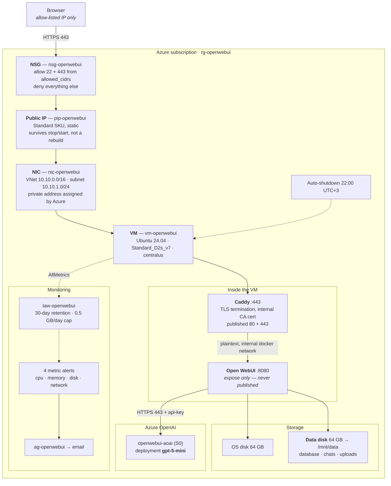
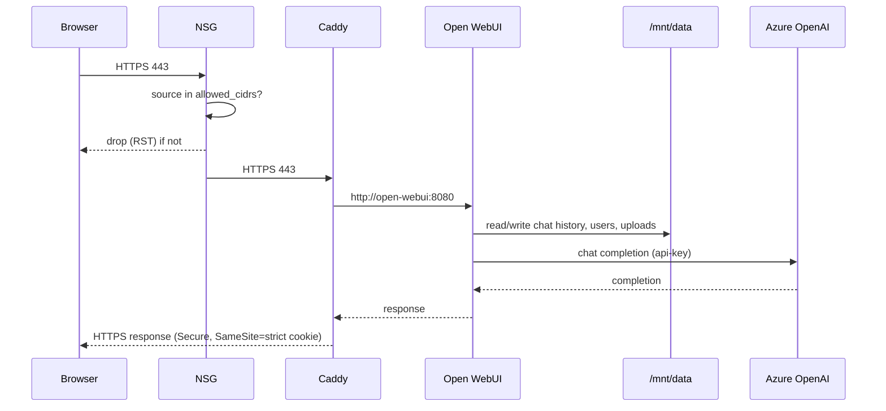

# Architecture

A private Open WebUI chat platform on a single Azure VM, fronted by Caddy over
HTTPS, backed by Azure OpenAI, and reachable only from an IP allow-list.

Everything lives in one resource group, `rg-openwebui`.

## Diagram

## Request path

1. A browser on an allow-listed IP opens `https://<vm-public-ip>`.
2. The **NSG** allows TCP 443 (and 22 for SSH) from `allowed_cidrs` and denies
   everything else, by Azure's default `DenyAllInBound` rule.
3. The **public IP** is `Standard` SKU and statically allocated, so the address
   survives a stop/start.
4. **Caddy** terminates TLS with a locally-generated certificate and reverse
   proxies to `open-webui:8080` on the private Docker network.
5. **Open WebUI** calls Azure OpenAI over HTTPS with the API key from `.env`.

Port 8080 is declared with `expose`, never `ports`, so it is never bound on the
host and cannot be reached from outside the VM.

## Why each piece is here

| Component | Reason |
|---|---|
| Static public IP | A Caddy internal certificate is bound to a fixed address; a changing IP would invalidate it and break the documented access URL. |
| NSG on the subnet | First control point. Nothing is open unless explicitly allowed. |
| UFW + `DOCKER-USER` | Host firewall mirroring the NSG. Needed because Docker publishes ports via DNAT and otherwise bypasses UFW entirely. |
| Caddy | TLS termination plus a single entry point. Open WebUI does not terminate TLS itself. |
| Managed data disk | The Open WebUI database and uploads live here, so they survive VM reimage and destroy/rebuild cycles. |
| Azure OpenAI | Managed model deployment; no model hosting on the VM. |
| Auto-shutdown 22:00 | Cost control. The VM is a development/portfolio deployment and is not needed overnight. |

## Data flow

## Trust boundaries

| Boundary | Control |
|---|---|
| Internet → Azure | NSG allow-list on 22 and 443 |
| Internet → VM host | UFW + `DOCKER-USER`, key-only SSH |
| VM host → container network | Only Caddy can reach Open WebUI; 8080 is not published |
| Container → Azure OpenAI | API key held in `.env` at mode 600, never in git |
| User → application | Open WebUI auth; registration open, but new accounts land as `pending` with no access until an admin approves |

## Known gaps

- **No log centralisation.** Container and syslog logs stay on the VM; only VM
  metrics reach Log Analytics. See `security.md` for why.
- **No high availability.** Single VM, single data disk, no load balancer. A
  regional outage takes the platform down.
- **Alerts are untested end to end.** Rules evaluate and report `Healthy`, but
  no alert has been deliberately fired to prove email delivery works.